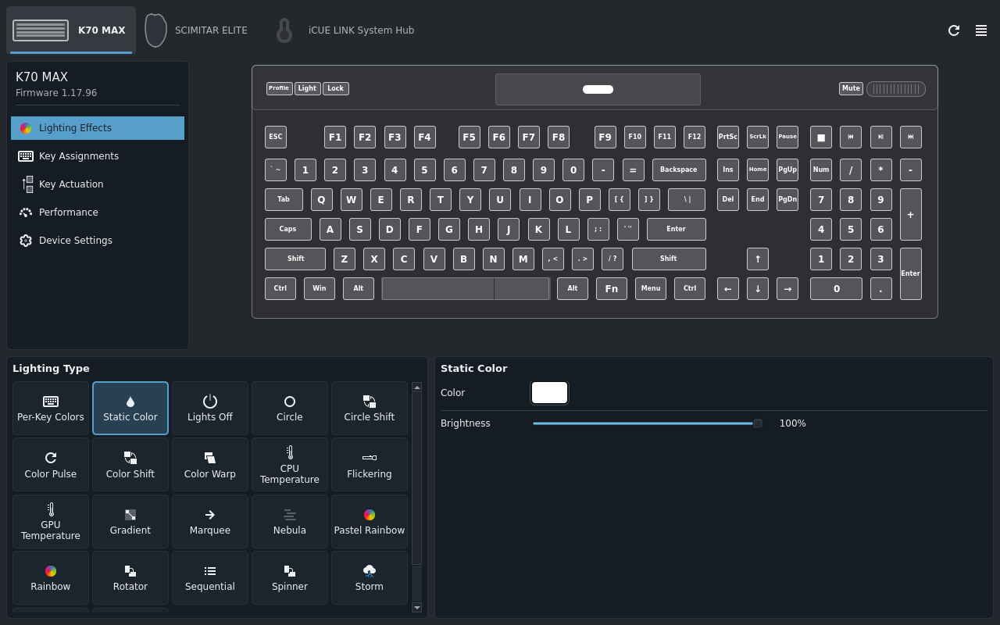
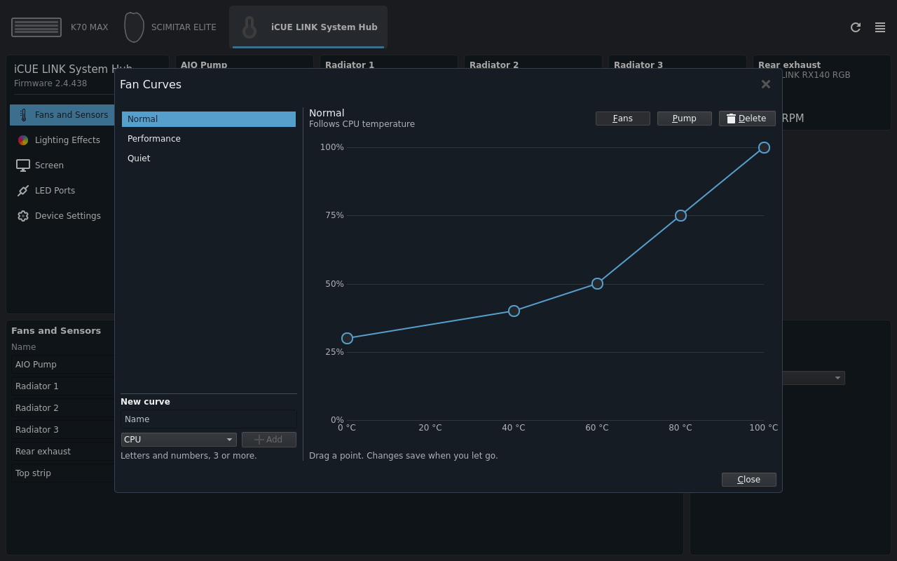

# Halo

A native KDE app for lighting, keys, DPI and cooling on Corsair gear under Linux.
Halo is a front end for [OpenLinkHub](https://github.com/jurkovic-nikola/OpenLinkHub),
which does the talking to the hardware. Halo ships its own copy, so there is nothing else to install.



| | |
|---|---|
|  |  |
|  |  |

Halo is an independent project. It is not made by, affiliated with or endorsed by Corsair.

## What it does

- **Keyboards:** lighting effects with a live preview, per-key colors, key assignments, actuation points, polling rate, game mode.
- **Mice:** button assignments, zone lighting, DPI stages (edit them and pick the active one), sleep and polling settings.
- **Headsets:** lighting and device settings.
- **Hubs, coolers, memory, power supplies:** live fan speeds, temperatures and power; fan curves (with an editor); lighting per part; LCD mode, rotation and images; LED port setup.
- **Everywhere:** changes apply as you make them; changes made on the device show up in the app within a moment.
- **Desktop:** tray icon with per-device profiles and battery, start at login, start minimized, low-battery alerts, lights off for everything.

## What has been tested

| Hardware | Status |
|---|---|
| K70 MAX keyboard | Used daily by the author |
| Scimitar Elite Wireless mouse | Used daily by the author |
| Everything else OpenLinkHub supports | Screens are built from OpenLinkHub's data format and tested against made-up devices only |

If you own other hardware and something looks wrong, please open an issue with the output of
`curl http://127.0.0.1:27003/api/devices/<serial>` (remove the serial numbers if you like).

Not in Halo yet: per-widget settings on the Xeneon Edge, per-LED colors on hubs, macros editing,
and temperature sources other than CPU, GPU and liquid for new fan curves. OpenLinkHub's own web page
at <http://127.0.0.1:27003> still offers all of these.

## Install

Halo is a Flatpak. Until it is on Flathub, download `halo.flatpak` from the
[latest release](https://github.com/mattehrhart/halo/releases/latest) and run:

```sh
flatpak install --user halo.flatpak
flatpak run io.github.mattehrhart.Halo
```

The first time, Halo shows a short setup page. Linux does not let ordinary programs talk to these
devices until a permission rule is installed; the page gives you one command to copy into a terminal.
That is the only step that needs `sudo`.

If you already run OpenLinkHub yourself, Halo uses it and does not start its own copy.
(Switching the active DPI stage needs Halo's copy; see [docs/ARCHITECTURE.md](docs/ARCHITECTURE.md).)

## Build from source

```sh
flatpak install flathub org.kde.Sdk//6.11 org.kde.Platform//6.11 org.freedesktop.Sdk.Extension.golang//25.08
flatpak-builder --user --install --force-clean flatpak-build io.github.mattehrhart.Halo.json
```

For day-to-day work, build with CMake inside the KDE SDK and run against the stand-in hub
(no hardware needed). [docs/TESTING.md](docs/TESTING.md) has the commands.

## Documentation

- [docs/ARCHITECTURE.md](docs/ARCHITECTURE.md): how the app is put together and how it talks to OpenLinkHub
- [docs/TESTING.md](docs/TESTING.md): the tests, the stand-in hub, and checking a screen by hand
- [docs/DEVICES.md](docs/DEVICES.md): how devices are drawn and how to add a diagram
- [docs/FLATHUB.md](docs/FLATHUB.md): what is left to publish on Flathub
- [CONTRIBUTING.md](CONTRIBUTING.md)

## License

GPL-3.0-or-later, the same as OpenLinkHub. See [LICENSE](LICENSE).
The bundled OpenLinkHub is built from its 0.9.4 source with a small patch,
[packaging/openlinkhub-halo.patch](packaging/openlinkhub-halo.patch).

Product names are trademarks of their owners and are used only to say which devices are supported.
Device outlines were drawn for this project; no manufacturer artwork is included.
