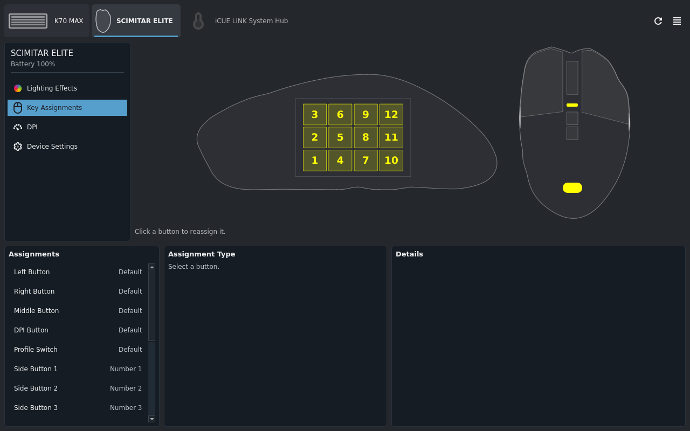
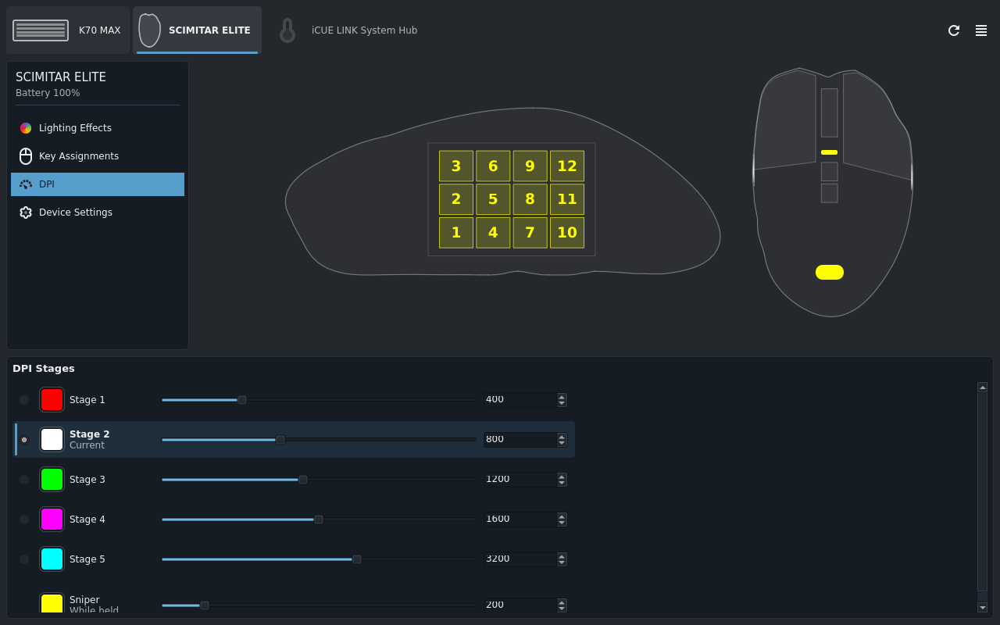
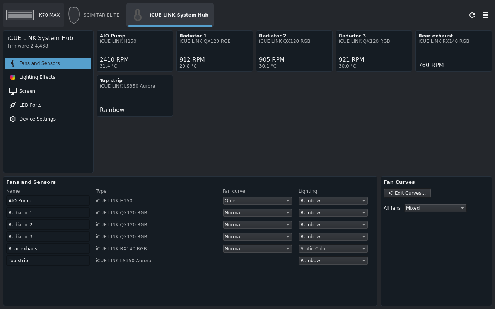

<p align="center">
  
</p>

<h1 align="center">Halo</h1>

Halo is a Linux app for Corsair keyboards, mice, headsets, fans and coolers. It is made for KDE and installs as a Flatpak.

Halo controls devices through [OpenLinkHub](https://github.com/jurkovic-nikola/OpenLinkHub), which is included.

Halo is not made or endorsed by Corsair.


| | |
|---|---|
|  |  |
|  |  |

## Features

Keyboards
- Lighting effects with a preview, and per-key colors
- Key assignments
- Actuation points, polling rate and game mode

Mice
- Button assignments
- Zone lighting
- DPI stages, including which one is active
- Sleep and polling settings

Headsets
- Lighting and device settings

Hubs, coolers, memory and power supplies
- Fan speeds, temperatures and power draw
- Fan curves, with an editor
- Lighting for each fan, strip or module
- LCD mode, rotation and images
- LED port setup

General
- Changes apply right away. There is no Apply button.
- A change made on the device, such as pressing the DPI button, shows in the app.
- Tray icon with profiles and battery level
- Start at login, start minimized, low-battery alerts
- One switch to turn all lights off

## Tested hardware

| Hardware | Status |
|---|---|
| K70 MAX keyboard | Tested |
| Scimitar Elite Wireless mouse | Tested |
| Other devices OpenLinkHub supports | Not tested on real hardware. Checked with simulated devices only. |

If something is wrong on your device, please open an issue and attach the output of
`curl http://127.0.0.1:27003/api/devices/<serial>`. You can remove the serial numbers.

Not in Halo yet:
- Settings for individual Xeneon Edge widgets
- Per-LED colors on hubs
- Editing macros
- Fan curves that follow anything other than CPU, GPU or liquid temperature

OpenLinkHub's web page at <http://127.0.0.1:27003> has all of these.

## Install

Halo is not on Flathub yet. Download `halo.flatpak` from the
[latest release](https://github.com/mattehrhart/halo/releases/latest), then run:

```sh
flatpak install --user halo.flatpak
flatpak run io.github.mattehrhart.Halo
```

On first run Halo shows a setup page with one command to paste into a terminal. Linux blocks access
to these devices until that command has been run. It needs `sudo` and only has to be done once.

If you already run OpenLinkHub, Halo uses yours. Picking the active DPI stage only works with the
copy included in Halo.

## Build from source

```sh
flatpak install flathub org.kde.Sdk//6.11 org.kde.Platform//6.11 org.freedesktop.Sdk.Extension.golang//25.08
flatpak-builder --user --install --force-clean flatpak-build io.github.mattehrhart.Halo.json
```

To work on Halo without any hardware, build it with CMake and run it against the simulated
devices in `tests/fakehub`. See [docs/TESTING.md](docs/TESTING.md).

## Documentation

- [Architecture](docs/ARCHITECTURE.md)
- [Testing](docs/TESTING.md)
- [How devices are drawn](docs/DEVICES.md)
- [Publishing on Flathub](docs/FLATHUB.md)
- [Making a release](docs/RELEASING.md)
- [Changelog](CHANGELOG.md)
- [Contributing](CONTRIBUTING.md)

## License

Halo is licensed under GPL-3.0-or-later. See [LICENSE](LICENSE).

The included OpenLinkHub is version 0.9.4 with one patch:
[packaging/openlinkhub-halo.patch](packaging/openlinkhub-halo.patch).

Product names are trademarks of their owners. The device drawings were made for Halo and do not
use manufacturer artwork.
